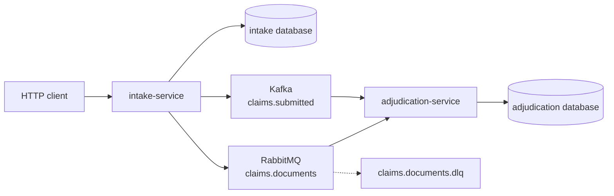
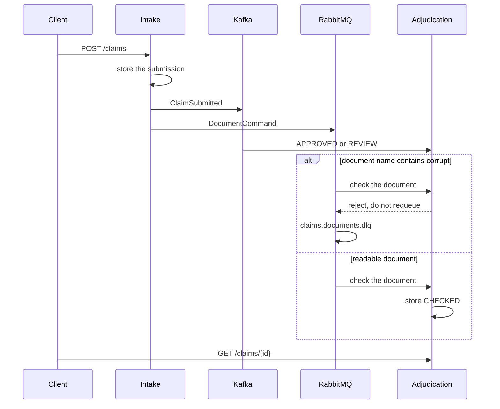

# Claims Desk

A claim comes in through intake. Adjudication decides it from the event log and checks the document from a work queue. The two services do not call each other.

An ordinary document under the review threshold is `APPROVED` and `CHECKED`. A document name containing `missing`, or an amount above 1,000,000 cents, is `REVIEW`. A document name containing `corrupt` is not checked: the worker rejects the message onto `claims.documents.dlq` and leaves the decision that came from the log.





Kafka and RabbitMQ can arrive in either order. Each writer upserts the same claim row. The decision writer fills in the outcome and does not clear a document status that is already there. The document writer marks `CHECKED` and does not clear a decision that is already there. A corrupt document never writes `CHECKED`.

There is no outbox. Intake publishes after the submission row is saved.

## Run

JDK 17, Maven 3.9, and Docker.

```bash
mvn -q -DskipTests package
docker compose up --build -d
./scripts/smoke.sh
```

| Process | URL |
| --- | --- |
| intake-service | http://localhost:8101 |
| adjudication-service | http://localhost:8102 |
| RabbitMQ management | http://localhost:15675 |
| Postgres | localhost:5435 |
| Kafka (host listener) | localhost:9096 |

```bash
docker compose down
```

## Calls

```bash
curl -s -X POST localhost:8101/claims \
  -H 'content-type: application/json' \
  -d '{"claimantName":"Mina","documentName":"policy.pdf","amountCents":2500}'

curl -s localhost:8102/claims/$CLAIM
```

`GET /claims/{id}` answers `404` until adjudication has stored a row.

## Where the same split goes on Google Cloud

This repository runs on Compose. Nothing in it calls a cloud account, and there is no Pub/Sub client in the process. The same two hops map onto Google Cloud like this:

| Compose | Google Cloud |
| --- | --- |
| Postgres 16 | Cloud SQL for PostgreSQL |
| Kafka 3.8 | a Pub/Sub topic for the claim log, or a managed Kafka |
| RabbitMQ 3.13 | a Pub/Sub subscription with a dead-letter topic |
| the two services | Cloud Run or GKE |

## Local credentials

The Compose network is open. Do not publish these ports.

| | |
| --- | --- |
| Postgres | `platform` / `platform` |
| RabbitMQ | `platform` / `platform`, vhost `/` |
| HTTP | no authentication |

## Tests

`mvn test` checks the decision and document rules with no Docker. `./scripts/smoke.sh` submits a healthy claim, a corrupt document, and an amount above the review line. It waits for `APPROVED` + `CHECKED`, a dead letter with no `CHECKED` status, and `REVIEW` + `CHECKED`.

## Same shape, different domain

- [Live Lobby](https://github.com/joshbarros/java-live-lobby) projects session registrations from Kafka and confirms them on RabbitMQ.
- [Loyalty Ledger](https://github.com/joshbarros/java-loyalty-ledger) repairs a points balance when a reward cannot be fulfilled.
